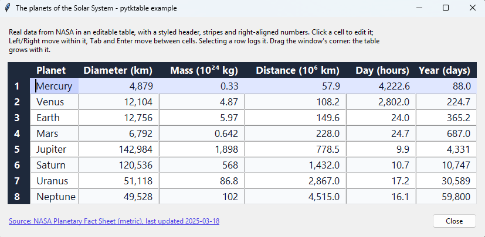

# pytktable

[](https://pypi.org/project/pytktable/)
[](https://pypi.org/project/pytktable/)
[](https://github.com/nbro/tktable/actions/workflows/tests.yml)
[](https://nbro.github.io/tktable/)
[](LICENSE.md)

A spreadsheet-like table widget for tkinter, wrapping the Tcl/Tk
[Tktable](https://wiki.tcl-lang.org/page/Tktable) extension.

> ⚠️ **Important:** pytktable is only the Python wrapper. The table widget itself is
> [Tktable](https://wiki.tcl-lang.org/page/Tktable), an extension for Tcl/Tk written in C, which
> `pip install pytktable` does not install. Install it with pytktable, prebuilt for Linux, macOS
> and Windows, with `pip install "pytktable[binary]"`, or install it yourself following the
> [installation instructions](https://nbro.github.io/tktable/installation/) for your OS. Then run
> `python -m tktable` to check that it works.

The wrapper was originally written by [Guilherme Polo](https://github.com/gpip). For the story
behind pytktable and its binaries, see [this blog post](https://nbro.gitlab.io/python/2026/11/04/pytktable-a-spreadsheet-like-table-widget-for-tkinter-wrapping-the-tcl-tk-tktable-extension/).



The [example](https://nbro.github.io/tktable/usage.html) above shows the planets of the Solar
System, from NASA's Planetary Fact Sheet (screenshot taken on Windows 11).

## Features

- Spreadsheet-like tables with title rows and columns, editable cells, and keyboard navigation.
- Cell values kept in an `ArrayVar` (a Tcl array), or computed on demand by a callback.
- Styling with tags: colors, fonts, alignment and relief, for single cells, rows or columns.
- Merged cells (spans), embedded widgets, and resizable rows and columns.
- Cells that flash when their value changes, with a color of your choice.
- Selection of cells, rows or columns; inserting and deleting rows and columns.
- Callbacks when the active cell changes, to compute cell values, to validate edits, and to
  format the selection when it is copied.
- Works on Linux, macOS and Windows, with Python 3.11 or later and Tcl/Tk 8.6 or 9.0, once
  Tcl/Tk (usually bundled with Python) and the Tktable extension are [installed](https://nbro.github.io/tktable/installation/).
- `python -m tktable` checks that Tktable can be found and loaded.

## Installation

With Tktable, prebuilt for Linux, macOS and Windows
([pytktable-binaries](https://github.com/nbro/pytktable-binaries)):

```sh
pip install "pytktable[binary]"
```

Without Tktable, if you install it yourself (see
[Installation](https://nbro.github.io/tktable/installation/)):

```sh
pip install pytktable
```

It is imported as `tktable` (`from tktable import Table`). Run `python -m tktable` to check that
Tktable can be found and loaded.

## Documentation

<https://nbro.github.io/tktable/>: usage, API reference, development and releasing.

## License

[BSD 2-Clause](LICENSE.md).

Copyright (c) 2008, Guilherme Polo\
Copyright (c) 2016-2026, nbro

See the [changelog](CHANGELOG.md) for what changed in this fork.
